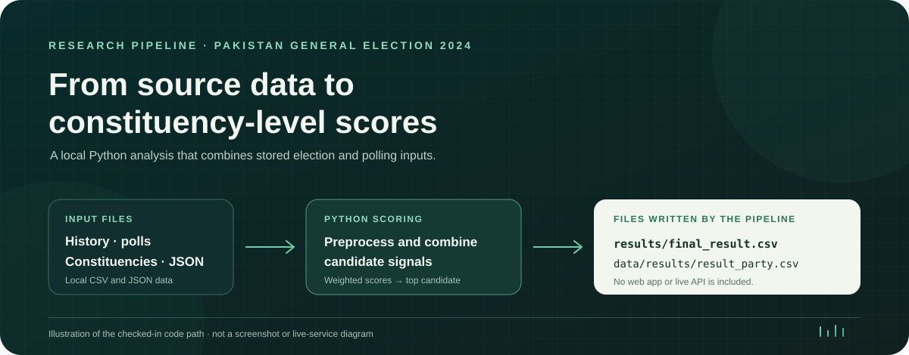
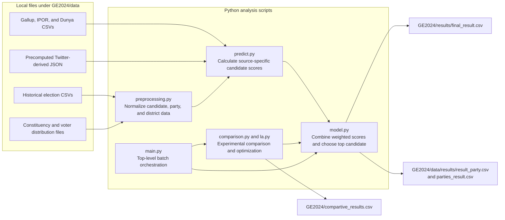

<div align="center">

# Pakistan Election Prediction 2024

**A local Python research project that combines historical election results, polling, constituency records, and precomputed social signals into candidate scores.**

[](https://github.com/Attayab-31/Pakistan-Election-Prediction-2024/stargazers)
[](https://github.com/Attayab-31/Pakistan-Election-Prediction-2024)
[](https://github.com/Attayab-31/Pakistan-Election-Prediction-2024/commits/main)

[Overview](#overview) · [Features](#features) · [Architecture](#system-architecture) · [Quickstart](#quickstart) · [Usage](#usage-and-output) · [Limitations](#security-and-limitations) · [License](#roadmap-and-license)

[⭐ Star this repository](https://github.com/Attayab-31/Pakistan-Election-Prediction-2024)

[](https://twitter.com/intent/tweet?url=https%3A%2F%2Fgithub.com%2FAttayab-31%2FPakistan-Election-Prediction-2024&text=Explore%20this%20Pakistan%20election%20prediction%20research%20project)
[](https://www.linkedin.com/sharing/share-offsite/?url=https%3A%2F%2Fgithub.com%2FAttayab-31%2FPakistan-Election-Prediction-2024)
[](https://www.facebook.com/sharer/sharer.php?u=https%3A%2F%2Fgithub.com%2FAttayab-31%2FPakistan-Election-Prediction-2024)
[](https://www.reddit.com/submit?url=https%3A%2F%2Fgithub.com%2FAttayab-31%2FPakistan-Election-Prediction-2024&title=Pakistan%20Election%20Prediction%202024)
[](https://api.whatsapp.com/send?text=Pakistan%20Election%20Prediction%202024%20https%3A%2F%2Fgithub.com%2FAttayab-31%2FPakistan-Election-Prediction-2024)



</div>

## Overview

This repository contains a research prototype for analyzing Pakistan’s 2024 general election. Its scripts read local CSV and JSON files, preprocess candidate and party records, combine several hand-weighted signal sources, select a top-scoring candidate for each constituency, and write CSV results.

It is a **batch analysis project**, not a deployed website, interactive dashboard, prediction API, or live data collector. The repository has no HTTP routes, authentication, environment-variable configuration, or runtime calls to external services.

## Features

- Normalize constituency, candidate, party, and district data for analysis.
- Calculate candidate-level scores from stored polling, historical-party, constituency-history, and precomputed Twitter-derived inputs.
- Use SciPy and Bayesian Optimization code for experimental weight estimation and method comparisons.
- Write constituency-level and party-level CSV outputs.
- Keep the input datasets and example output files alongside the analysis scripts.

### What is implemented and what is not

| Included in the repository | Not included |
| --- | --- |
| Python scripts for preprocessing, scoring, model aggregation, and comparisons | Web UI, screenshots of a running application, or live demo site |
| Local CSV/JSON/XLSX datasets and stored results | REST/GraphQL API, routes, authentication, or database |
| A JSON file consumed by the Twitter signal function | Twitter client, live scraping, or API credentials |
| A script that writes result files when run | Automated tests, CI workflows, deployment, or packaged CLI |

## Demo and example output

There is no interactive demo because the project has no application interface. The banner above is an architecture illustration, not a screenshot. A checked-in example output is available at [`GE2024/results/final_result.csv`](GE2024/results/final_result.csv). It contains the columns `Constituency`, `Predicted Winning Serial Number`, and `Predicted Winning Name of Candidate`; it should be treated as a stored artifact, not as a result reproduced or validated by this README.

## System architecture



`main.py` runs as soon as Python executes the file; it is not a parameterized command-line interface. It invokes optimization and comparison code as well as generating outputs. The `predict_twitter` function only reads the committed JSON input; data collection happens outside this repository, if at all.

## Technology stack

| Technology | Use in this project |
| --- | --- |
| Python 3.12 | Runtime represented by the checked-in environment metadata |
| pandas and NumPy | Tabular preprocessing and numerical score calculations |
| SciPy | Linear algebra and optimization routines |
| `bayesian-optimization` | Experimental parameter search in `ml.py` |
| tqdm | Progress display in batch loops |
| Matplotlib | Imported by optimization modules; no application UI is built |

## Project structure

```text
.
├── README.md
├── .gitignore
├── assets/
│   └── readme-pipeline.svg
└── GE2024/
    ├── main.py                 # Batch entry point; has top-level side effects
    ├── preprocessing.py        # Candidate, party, and district normalization
    ├── predict.py              # Source-specific candidate scoring functions
    ├── model.py                # Weighted constituency predictions
    ├── comparison.py            # Method comparisons and score calculations
    ├── la.py                   # Linear algebra and linear-programming experiments
    ├── ml.py                   # Bayesian Optimization experiments
    ├── utils.py                # Result conversion and historical helpers
    ├── requirements.txt        # Pinned direct Python dependencies
    ├── data/                   # Election, polling, history, and JSON inputs
    └── results/                # Stored/generated constituency output
```

The `Perevious_Results` folder name is misspelled in the existing tree; scripts use that spelling. Keep the current directory name unless the code paths are updated with it.

## Quickstart

The source uses Windows-style relative file paths. Use **Python 3.12 on Windows** and run the pipeline from `GE2024`, because its data paths are relative to that working directory.

From the repository root in PowerShell:

```powershell
py -3.12 -m venv .venv
.\.venv\Scripts\python.exe -m pip install --upgrade pip
.\.venv\Scripts\python.exe -m pip install -r .\GE2024\requirements.txt
Push-Location .\GE2024
..\.venv\Scripts\python.exe .\main.py
Pop-Location
```

The script can take a while because it launches optimization and comparison work. It overwrites generated files, including `GE2024/results/final_result.csv`, `GE2024/data/results/result_party.csv`, `GE2024/data/results/parties_result.csv`, and `GE2024/compartive_results.csv`. Commit or copy any local edits to those files before running the pipeline.

The virtual environment directory is ignored by Git. The repository’s existing environment was created on another machine and should not be reused; create a fresh one with the commands above.

## Usage and output

There is no HTTP API, request body, response payload, or environment-variable configuration to document. The available interfaces are Python functions and the `main.py` batch script.

| Entry point | Behavior |
| --- | --- |
| `preprocessing.NA_list_preprocessed()` | Reads `data/Election_2024_Stats/NA_List.csv`, normalizes party labels, and derives a district column. |
| `predict.predict_gallup(data, survey_name=...)` | Reads a survey CSV from `data/Gallup_Surveys/` and returns one score per candidate row. |
| `predict.predict_dunya(data)` | Reads the stored Dunya survey file and returns candidate scores. |
| `predict.predict_partyHistory(data)` | Reads the stored party-history probabilities and returns candidate scores. |
| `predict.predict_districtHistory(data, file_name=...)` | Reads a preprocessed election-history CSV and returns candidate scores. |
| `predict.predict_twitter(data)` | Reads `data/twitter/pakistan.json` and maps its stored party signals to candidates. |
| `model.final_model(weights)` | Aggregates twelve weighted source scores, writes the constituency result and party files, and returns a party-count Series plus a seat-level DataFrame. |
| `comparison.compare_methods(method)` | Runs one of the source’s method labels and returns a comparison list if the workflow completes. |

The twelve weights used by `final_model` correspond, in order, to Dunya, five survey files (four Gallup files and one IPOR file), party history, four historical election files (2002, 2008, 2013, 2018), and the stored Twitter-derived signal. The current `main.py` later replaces values from earlier optimizer calls with hard-coded weights, so those initial calls are not a user-facing tuning interface.

The normal constituency output has three columns: constituency, predicted winning serial number, and predicted winning candidate name. `utils.results_to_party()` adds party affiliation and also writes a party-count CSV.

## Testing and build

No automated test suite, package build configuration, or CI workflow is present. There is no test or build badge in this README. To check Python syntax without running the full pipeline, use:

```powershell
py -3.12 -m py_compile .\GE2024\main.py .\GE2024\preprocessing.py .\GE2024\predict.py .\GE2024\model.py .\GE2024\comparison.py .\GE2024\la.py .\GE2024\ml.py .\GE2024\utils.py
```

This is a syntax check only; it does not validate model behavior, dataset correctness, or output accuracy.

## Security and limitations

- The scripts use the checked-in data files and do not read credentials or environment variables. There is no `.env.example` because the code has no environment-based configuration.
- The runtime code does not call a hosted polling, Twitter, or election service. The Twitter-derived input is a local JSON file.
- Dataset provenance, source URLs, and redistribution terms are not documented for all included files. Check the original providers’ terms before reusing or redistributing the data.
- The scoring logic is experimental. The code combines manually supplied weights and contains legacy optimization/comparison paths; the repository does not establish calibration, statistical validity, or forecast accuracy.
- Running `main.py` has side effects and overwrites generated CSV files. Run it from a clean copy or back up local result edits first.
- The scripts assume Windows-style paths and a specific working directory. Cross-platform path support is not implemented.
- A current-tree filename and common-token-pattern scan found no obvious credentials. It was not a full Git-history secret scan; rotate any credential that may have been committed previously.

## Roadmap and license

The project code is licensed under the **GNU Affero General Public License, version 3 only (AGPL-3.0-only)**. See [`LICENSE`](LICENSE) for the complete license text. The AGPL does not change the separate terms that may apply to third-party datasets in `GE2024/data`; review each source’s reuse terms before redistributing that data. See the [GNU AGPLv3 page](https://www.gnu.org/licenses/agpl-3.0.en.html) for the license’s official description.

No roadmap or release schedule is published in the repository.

## Contact and community

- **Author credited in the original README:** Muhammad Attayab Ashraf
- **Repository maintainer account:** [@Attayab-31](https://github.com/Attayab-31)
- **Questions and bug reports:** [open a GitHub issue](https://github.com/Attayab-31/Pakistan-Election-Prediction-2024/issues)
- **Contributions:** use a focused branch and pull request, and include data provenance for any dataset changes.

Issues are enabled on the repository. GitHub Discussions, contribution guidelines, and a code of conduct are not currently configured.
